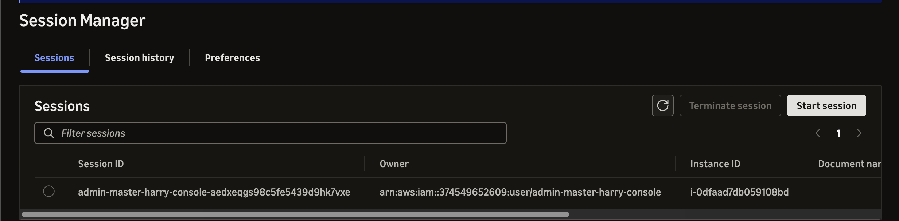

### Install SessionManager Plugin on your laptop
```
https://docs.aws.amazon.com/systems-manager/latest/userguide/install-plugin-macos-overview.html
```
```
curl "https://s3.amazonaws.com/session-manager-downloads/plugin/latest/mac_arm64/session-manager-plugin.pkg" -o "session-manager-plugin.pkg"
```
```
sudo installer -pkg session-manager-plugin.pkg -target /

sudo ln -s /usr/local/sessionmanagerplugin/bin/session-manager-plugin /usr/local/bin/session-manager-plugin
```
```
rm -rf session-manager-plugin.pkg 
```

### Terraform Outputs
```
Outputs:

instance_ids = {
  "instance01" = "i-0b1bb7c7f55111fec"
  "instance02" = "i-069684c79e25c8c7e"
  "instance03" = "i-0dfaad7db059108bd"
}
session_manager_commands = {
  "instance01" = "aws ssm start-session --target i-0b1bb7c7f55111fec"
  "instance02" = "aws ssm start-session --target i-069684c79e25c8c7e"
  "instance03" = "aws ssm start-session --target i-0dfaad7db059108bd"
}
session_manager_role_arn = "arn:aws:iam::xxxxxxx:role/frontend-session-manager-role"
vpc_endpoints = {
  "ec2_messages" = "vpce-0155ac603c2db2dec"
  "ssm" = "vpce-07ad51b32c2297511"
  "ssm_messages" = "vpce-080635a8e8c789ac7"
}
```

## To Connect to your private EC2 instances
### To connect to private instance 01
```
$ aws ssm start-session --target i-0b1bb7c7f55111fec --profile admin-master-harry-console

Starting session with SessionId: admin-master-harry-console-6onvbyry8azyl7fiungog7sboa
$ whoami
ssm-user
$ ip a
1: lo: <LOOPBACK,UP,LOWER_UP> mtu 65536 qdisc noqueue state UNKNOWN group default qlen 1000
    link/loopback 00:00:00:00:00:00 brd 00:00:00:00:00:00
    inet 127.0.0.1/8 scope host lo
       valid_lft forever preferred_lft forever
    inet6 ::1/128 scope host noprefixroute 
       valid_lft forever preferred_lft forever
2: enX0: <BROADCAST,MULTICAST,UP,LOWER_UP> mtu 9001 qdisc fq_codel state UP group default qlen 1000
    link/ether 06:ff:e4:5b:7e:81 brd ff:ff:ff:ff:ff:ff
    inet 10.0.253.166/24 metric 100 brd 10.0.253.255 scope global dynamic enX0
       valid_lft 2847sec preferred_lft 2847sec
    inet6 fe80::4ff:e4ff:fe5b:7e81/64 scope link 
       valid_lft forever preferred_lft forever
$ hostname
ip-10-0-253-166
```
### To connect to private instance 02
```
$ aws ssm start-session --target i-069684c79e25c8c7e --profile admin-master-harry-console

Starting session with SessionId: admin-master-harry-console-dtn8c9ua2h5nyzy5i3v6ixd3di
$ whoami
ssm-user
$ ip a
1: lo: <LOOPBACK,UP,LOWER_UP> mtu 65536 qdisc noqueue state UNKNOWN group default qlen 1000
    link/loopback 00:00:00:00:00:00 brd 00:00:00:00:00:00
    inet 127.0.0.1/8 scope host lo
       valid_lft forever preferred_lft forever
    inet6 ::1/128 scope host noprefixroute 
       valid_lft forever preferred_lft forever
2: enX0: <BROADCAST,MULTICAST,UP,LOWER_UP> mtu 9001 qdisc fq_codel state UP group default qlen 1000
    link/ether 02:ff:ef:7e:22:0f brd ff:ff:ff:ff:ff:ff
    inet 10.0.254.228/24 metric 100 brd 10.0.254.255 scope global dynamic enX0
       valid_lft 2428sec preferred_lft 2428sec
    inet6 fe80::ff:efff:fe7e:220f/64 scope link 
       valid_lft forever preferred_lft forever
$ hostname
ip-10-0-254-228
```

### To connect to private instance 03
```
aws ssm start-session --target i-0dfaad7db059108bd --profile admin-master-harry-console

Starting session with SessionId: admin-master-harry-console-vq29ij4ihiapctneizcyo93ry4
$ whoami
ssm-user
$ ip a
1: lo: <LOOPBACK,UP,LOWER_UP> mtu 65536 qdisc noqueue state UNKNOWN group default qlen 1000
    link/loopback 00:00:00:00:00:00 brd 00:00:00:00:00:00
    inet 127.0.0.1/8 scope host lo
       valid_lft forever preferred_lft forever
    inet6 ::1/128 scope host noprefixroute 
       valid_lft forever preferred_lft forever
2: enX0: <BROADCAST,MULTICAST,UP,LOWER_UP> mtu 9001 qdisc fq_codel state UP group default qlen 1000
    link/ether 0a:ff:e6:4d:e0:63 brd ff:ff:ff:ff:ff:ff
    inet 10.0.255.50/24 metric 100 brd 10.0.255.255 scope global dynamic enX0
       valid_lft 2327sec preferred_lft 2327sec
    inet6 fe80::8ff:e6ff:fe4d:e063/64 scope link 
       valid_lft forever preferred_lft forever
$ hostname
ip-10-0-255-50
```
## Download files from S3 on private EC2 instances

SCP over Session Manager needs an SSH server and SSH key management. For S3 downloads, Session Manager gives you a shell on the private EC2 instance and the instance fetches the file directly from S3 over HTTPS. This removes the need to install or maintain SSH keys for these transfers. Both methods can keep the instance's inbound ports closed. [AWS guidance on SSH over Session Manager](https://docs.aws.amazon.com/systems-manager/latest/userguide/session-manager-getting-started-enable-ssh-connections.html)

### Network and access controls

- [session-manager.tf](session-manager.tf) allows outbound TCP 443 from the instance security group to the regional S3 prefix list. The existing Session Manager egress rules let you open the shell.
- [fe-vpc.tf](fe-vpc.tf) associates the S3 gateway endpoint with the three private route tables. AWS adds the S3 prefix-list route to each associated table. The endpoint and artifacts bucket must be in the same Region. [AWS gateway endpoint documentation](https://docs.aws.amazon.com/vpc/latest/privatelink/vpc-endpoints-s3.html)
- The endpoint policy allows only `s3:GetObject` for objects in the configured artifacts bucket. [policy.tf](policy.tf) grants those downloads over HTTPS when the request comes through this gateway endpoint, using `aws:SourceVpce` and `aws:SecureTransport`.

The bucket policy's endpoint condition limits that grant. A separate IAM grant can still authorize downloads from another network. To enforce endpoint-only downloads across all grants, use an explicit `Deny` for `s3:GetObject` requests that come from outside the approved endpoint. [AWS bucket policy examples](https://docs.aws.amazon.com/AmazonS3/latest/userguide/example-bucket-policies-vpc-endpoint.html)

### 1. Generate a presigned URL locally

From a machine with the AWS CLI and permission to read the object, run:

```bash
aws s3 presign \
  s3://frontend-ssm-artifacts-object-storage/document.txt \
  --expires-in 3600 \
  --region ap-southeast-1 \
  --profile admin-master-harry-console
```

The command prints a download URL for `document.txt` that is valid for up to one hour. Temporary signing credentials can expire sooner. Keep the full URL private while it is valid. [AWS presigned URL documentation](https://docs.aws.amazon.com/AmazonS3/latest/userguide/using-presigned-url.html)

### 2. Download the file from the private instance

Open a Session Manager shell on the instance, then run `curl` with the full URL from the previous step. The instance only needs `curl` and network access to S3 for this download. The AWS CLI and signing credentials stay on the machine that generated the link.

```bash
curl --fail --location --silent --show-error \
  --connect-timeout 5 --max-time 60 \
  --output /tmp/data.txt \
  'PASTE_ENTIRE_PRESIGNED_URL_HERE'
```

Keep the URL in single quotes. After `curl` succeeds, run `ls -l /tmp/data.txt` to verify the file.

## Architecture


### Session Manager Register Nodes


### Session Manager Traceability & Goverance


