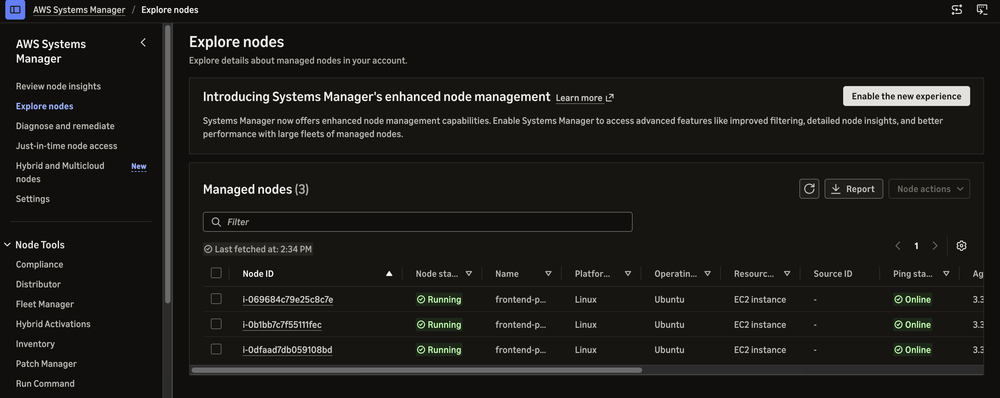
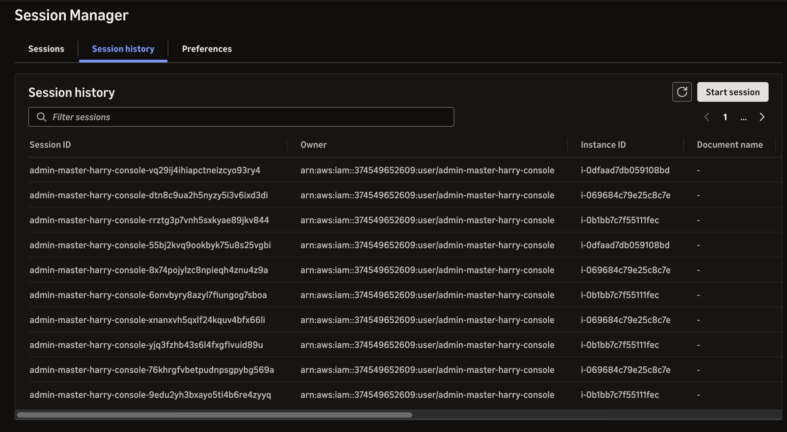

### Install SessionManager Plugin on your laptop
```
https://docs.aws.amazon.com/systems-manager/latest/userguide/install-plugin-macos-overview.html
```
```
curl "https://s3.amazonaws.com/session-manager-downloads/plugin/latest/mac_arm64/session-manager-plugin.pkg" -o "session-manager-plugin.pkg"
```
```
sudo installer -pkg session-manager-plugin.pkg -target /

sudo ln -s /usr/local/sessionmanagerplugin/bin/session-manager-plugin /usr/local/bin/session-manager-plugin
```
```
rm -rf session-manager-plugin.pkg 
```

### Terraform Outputs
```
Outputs:

instance_ids = {
  "instance01" = "i-0b1bb7c7f55111fec"
  "instance02" = "i-069684c79e25c8c7e"
  "instance03" = "i-0dfaad7db059108bd"
}
session_manager_commands = {
  "instance01" = "aws ssm start-session --target i-0b1bb7c7f55111fec"
  "instance02" = "aws ssm start-session --target i-069684c79e25c8c7e"
  "instance03" = "aws ssm start-session --target i-0dfaad7db059108bd"
}
session_manager_role_arn = "arn:aws:iam::xxxxxxx:role/frontend-session-manager-role"
vpc_endpoints = {
  "ec2_messages" = "vpce-0155ac603c2db2dec"
  "ssm" = "vpce-07ad51b32c2297511"
  "ssm_messages" = "vpce-080635a8e8c789ac7"
}
```

## To Connect to your private EC2 instances
### To connect to private instance 01
```
$ aws ssm start-session --target i-0b1bb7c7f55111fec --profile admin-master-harry-console

Starting session with SessionId: admin-master-harry-console-6onvbyry8azyl7fiungog7sboa
$ whoami
ssm-user
$ ip a
1: lo: <LOOPBACK,UP,LOWER_UP> mtu 65536 qdisc noqueue state UNKNOWN group default qlen 1000
    link/loopback 00:00:00:00:00:00 brd 00:00:00:00:00:00
    inet 127.0.0.1/8 scope host lo
       valid_lft forever preferred_lft forever
    inet6 ::1/128 scope host noprefixroute 
       valid_lft forever preferred_lft forever
2: enX0: <BROADCAST,MULTICAST,UP,LOWER_UP> mtu 9001 qdisc fq_codel state UP group default qlen 1000
    link/ether 06:ff:e4:5b:7e:81 brd ff:ff:ff:ff:ff:ff
    inet 10.0.253.166/24 metric 100 brd 10.0.253.255 scope global dynamic enX0
       valid_lft 2847sec preferred_lft 2847sec
    inet6 fe80::4ff:e4ff:fe5b:7e81/64 scope link 
       valid_lft forever preferred_lft forever
$ hostname
ip-10-0-253-166
```
### To connect to private instance 02
```
$ aws ssm start-session --target i-069684c79e25c8c7e --profile admin-master-harry-console

Starting session with SessionId: admin-master-harry-console-dtn8c9ua2h5nyzy5i3v6ixd3di
$ whoami
ssm-user
$ ip a
1: lo: <LOOPBACK,UP,LOWER_UP> mtu 65536 qdisc noqueue state UNKNOWN group default qlen 1000
    link/loopback 00:00:00:00:00:00 brd 00:00:00:00:00:00
    inet 127.0.0.1/8 scope host lo
       valid_lft forever preferred_lft forever
    inet6 ::1/128 scope host noprefixroute 
       valid_lft forever preferred_lft forever
2: enX0: <BROADCAST,MULTICAST,UP,LOWER_UP> mtu 9001 qdisc fq_codel state UP group default qlen 1000
    link/ether 02:ff:ef:7e:22:0f brd ff:ff:ff:ff:ff:ff
    inet 10.0.254.228/24 metric 100 brd 10.0.254.255 scope global dynamic enX0
       valid_lft 2428sec preferred_lft 2428sec
    inet6 fe80::ff:efff:fe7e:220f/64 scope link 
       valid_lft forever preferred_lft forever
$ hostname
ip-10-0-254-228
```

### To connect to private instance 03
```
aws ssm start-session --target i-0dfaad7db059108bd --profile admin-master-harry-console

Starting session with SessionId: admin-master-harry-console-vq29ij4ihiapctneizcyo93ry4
$ whoami
ssm-user
$ ip a
1: lo: <LOOPBACK,UP,LOWER_UP> mtu 65536 qdisc noqueue state UNKNOWN group default qlen 1000
    link/loopback 00:00:00:00:00:00 brd 00:00:00:00:00:00
    inet 127.0.0.1/8 scope host lo
       valid_lft forever preferred_lft forever
    inet6 ::1/128 scope host noprefixroute 
       valid_lft forever preferred_lft forever
2: enX0: <BROADCAST,MULTICAST,UP,LOWER_UP> mtu 9001 qdisc fq_codel state UP group default qlen 1000
    link/ether 0a:ff:e6:4d:e0:63 brd ff:ff:ff:ff:ff:ff
    inet 10.0.255.50/24 metric 100 brd 10.0.255.255 scope global dynamic enX0
       valid_lft 2327sec preferred_lft 2327sec
    inet6 fe80::8ff:e6ff:fe4d:e063/64 scope link 
       valid_lft forever preferred_lft forever
$ hostname
ip-10-0-255-50
```

## Copy files with SCP over Session Manager

Use AWS Systems Manager Session Manager to copy files to a private EC2 instance over SSH. The instance needs to be managed by Systems Manager, with SSM Agent and an SSH server running. Install the AWS CLI and the Session Manager plugin on your local machine. The AWS CLI profile needs permission to start a session on the instance using the `AWS-StartSSHSession` document. The instance security group can keep inbound port 22 closed. [AWS guide to SSH over Session Manager](https://docs.aws.amazon.com/systems-manager/latest/userguide/session-manager-getting-started-enable-ssh-connections.html)

The examples use the `admin-master-harry-console` profile, instance `i-0e4dfa513b086b3a8`, and Region `ap-southeast-1`. Use the instance ID from your Terraform `instance_ids` output if yours differs, and update the Region and profile for your environment.

### 1. Generate an SSH key locally

```bash
mkdir -p ~/.ssh
chmod 700 ~/.ssh
ssh-keygen -t ed25519 -f ~/.ssh/ssm-transfer
cat ~/.ssh/ssm-transfer.pub
```

Copy the line from `ssm-transfer.pub`. Keep the private key `ssm-transfer` on your local machine.

### 2. Connect to EC2 using Session Manager

```bash
aws ssm start-session \
  --target i-0e4dfa513b086b3a8 \
  --region ap-southeast-1 \
  --profile admin-master-harry-console
```

### 3. Add the public key for `ssm-user`

In the Session Manager shell, run `whoami` to confirm you are `ssm-user`. Then open that user's authorized keys file.

```bash
mkdir -p ~/.ssh
chmod 700 ~/.ssh
vi ~/.ssh/authorized_keys
```

Append the public key on its own line and preserve the existing keys. Save the file and set its permissions.

```bash
chmod 600 ~/.ssh/authorized_keys
```

### 4. Check the SSH service on the instance

On Ubuntu, check that `ssh` is active and that port 22 is listening.

```bash
sudo systemctl status ssh --no-pager
sudo ss -lntp | grep ':22'
```

If the status shows `disabled` alongside `active (running)`, check for `TriggeredBy: ssh.socket`. Ubuntu can start SSH on demand through that socket. Run `exit` to return to your local shell.

### 5. Add the SSH proxy configuration locally

Open `~/.ssh/config` and append this host block.

```sshconfig
Host private-ec2
    HostName ip-10-0-253-176
    User ssm-user
    IdentityFile ~/.ssh/ssm-transfer
    IdentitiesOnly yes
    ProxyCommand /opt/homebrew/bin/aws ssm start-session --target i-0e4dfa513b086b3a8 --region ap-southeast-1 --profile admin-master-harry-console --document-name AWS-StartSSHSession --parameters portNumber=%p
```

If your AWS CLI is installed elsewhere, use the path returned by `command -v aws`. The EC2 instance ID in `--target` selects the Session Manager target.

```bash
chmod 600 ~/.ssh/config ~/.ssh/ssm-transfer
```

### 6. Test SSH and copy the file

Test the SSH connection first, then exit the SSH session. From your local shell, copy `data.txt` to `ssm-user`'s home directory.

```bash
ssh private-ec2
```

```bash
scp data.txt private-ec2:/home/ssm-user/
```

## Architecture


### Session Manager Register Nodes


### Session Manager Traceability & Goverance


